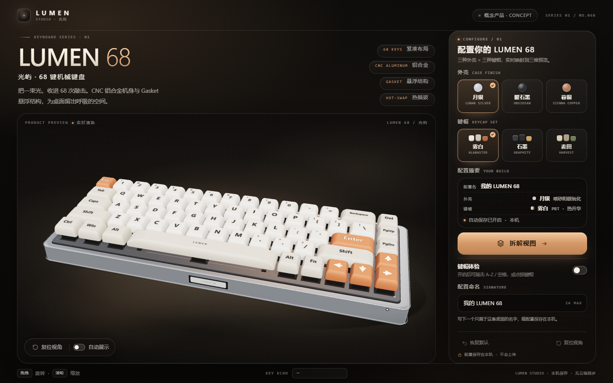
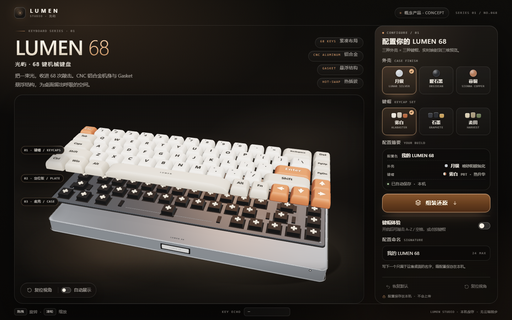

# LUMEN 68 / 光屿

[](https://github.com/zhaoxuejie/lumen-68/actions/workflows/deploy-pages.yml)

> 原创概念机械键盘的交互式 3D 产品展示与配置页面。
> **在线演示：** <https://zhaoxuejie.github.io/lumen-68/> ｜ **源码：** <https://github.com/zhaoxuejie/lumen-68>
> **查看方式 1：** 直接双击根目录的 **`LUMEN-68.html`**（单文件离线版，无需服务器/网络）。
> **查看方式 2：** `npm run dev` 启动 Vite 开发服务器。



**LUMEN 68** 是一把虚构的 68 键紧凑机械键盘：CNC 铝合金一体式楔形底壳、Gasket 悬浮结构、热插拔轴座、PBT 键帽。
本页面用 Three.js 程序化建模展示产品，用正常 HTML/CSS 承载配置界面——Canvas 里只有键盘，不承载页面 UI。

---

## 1. 功能一览

- **首屏产品展示**：产品名 / 简述 / 完整 3D 键盘 / 主要配置控件同时出现，桌面 1440×900 与 1280×800 无纵向滚动。
- **66 键紧凑布局（5 行，15 / 15 / 14 / 13 / 9）**：字母区、数字行、方向键、7u 空格、2u 回车、2.25u / 2.5u 双 Shift，键帽有高度、间隙、可读字符与雕刻式行倾角。
- **三种外壳 × 三种键帽主题任意组合**：月银 / 曜石黑 / 暮铜 × 雾白 / 石墨 / 麦田；面板、配置摘要、3D 材质颜色实时同步（材质颜色平滑过渡）。
- **拆解 / 组装**：键帽、定位板（含轴体、卫星轴、开孔、螺丝）、底壳三层平滑展开与复原；层标签随层定位；快速连点后仍会精确停在最后请求的状态。
- **键帽体验模式**：开启后按物理键盘 `A–Z` 或 `空格`，对应键帽下压回弹；鼠标/触屏可直接点按键帽；输入框获得焦点时**不会**被劫持，正常输入文字。
- **视角操作**：拖拽旋转、滚轮缩放、`复位视角`、双击画面复位、`自动展示`；拆解时相机自动轻微拉远/上移，保证完整构图。
- **配置持久化**：外壳、键帽、自定义配置名自动保存在 `localStorage`；刷新自动恢复；`恢复默认` 只删除本页自己的存储键，不影响其他站点/页面的数据。
- **完全离线**：系统字体、内联 SVG 图标、运行时程序化生成全部几何与纹理，无任何外部网络请求。



## 2. 快速开始

环境要求：Node.js ≥ 18（本项目在 Node 22 + npm 10 下开发验证）。

```powershell
npm install        # 安装依赖（three / vite / playwright-core 验证工具）
npm run dev        # 启动开发服务器：http://127.0.0.1:5173
```

生产构建：

```powershell
npm run build        # 常规构建，输出到 dist/
npm run build:single # 构建 + 内联为单文件，输出根目录 LUMEN-68.html
```

`LUMEN-68.html` 为 ~571 KB 的完全自包含文件：Three.js、CSS、所有纹理（运行时生成）均在内联的同一个 HTML 中，
可双击直接打开、拷贝到任意静态目录或用任意静态服务器托管，无需网络。

## 3. 使用方式

### 视角
| 操作 | 效果 |
| --- | --- |
| 在 3D 区域拖拽 | 旋转查看产品 |
| 鼠标滚轮 / 触控板缩放 | 拉近 / 拉远 |
| `复位视角`（视口左下或面板底部） | 平滑飞回默认产品角 |
| 双击 3D 区域 | 复位视角 |
| `自动展示` 开关 | 相机缓慢环绕（默认关闭） |

### 配置
1. 在右侧面板选择**外壳**（3 种）与**键帽**（3 种），可任意组合，3D 预览、选中态与「配置摘要」同步变化。
2. 可在「配置命名」中为当前配置起名（最长 24 字符），命名随配置保存。
3. 所有改动自动写入浏览器本机存储，状态行会显示保存状态。
4. `恢复默认`：恢复月银 + 雾白 + 默认名称，并仅删除本页的 `lumen68.config.v1` 存储项。

### 拆解 / 组装
- 点击主按钮 `拆解视图`：键帽层、定位板层、底壳三层依次分离，并显示层标签；按钮变为 `组装还原`。
- 再次点击平滑复原；连续快速点击时按钮与逻辑目标立即切换，动画始终收敛到最后一次请求的位置。

### 键帽体验
- 打开 `键帽体验` 开关后：按下物理键盘 `A–Z` 或 `空格`，对应键帽实时下压并回弹；页脚 `KEY ECHO` 显示按键回显。
- 鼠标或触屏可直接点击/点按键帽体验按压。
- **焦点保护**：焦点位于输入框、按钮等可交互控件时，按键不会被 3D 体验模式拦截，输入框正常打字；焦点在画布/空白区域时才触发键帽。
- 体验模式关闭时，物理键盘输入不会被页面拦截。

### 持久化说明
配置存储键为 `lumen68.config.v1`，内容示例：

```json
{"caseId":"copper","keycapId":"harvest","profileName":"我的桌面配置"}
```

刷新页面后自动恢复外壳、键帽与配置名。不同浏览器对 `file://` 页面是否允许 `localStorage` 有不同策略；
即使存储不可用，页面仍可正常使用（状态行会显示「仅本次会话」），通过静态服务器访问时持久化行为完整。

## 4. 模型与视觉实现

全部几何体由代码生成，无外部模型/贴图资源：

- **底壳**：圆角矩形截面放样（lofted rounded-rect），底面平整、上表面带 4.2° 倾角形成楔形；包含机身分模线装饰环、前置黄铜铭牌、电源指示灯与橡胶脚垫。
- **键帽**：每颗键帽是按行高度/倾角参数化的锥形放样体（下宽上窄、圆角收边），66 颗独立可动；字符图例用 Canvas 生成白色 alpha 蒙版，按主题材质颜色着色，含双字符数字/符号键、方向键箭头与空格 wordmark。
- **定位板**：阳极氧化色薄板，覆盖轴体开孔暗缝、4 颗固定螺丝；轴上盖与十字轴心以实例化网格绘制，宽键下方有卫星轴与钢丝。
- **材质与光照**：`RoomEnvironment` + PMREM 生成环境反射，ACES Filmic 色调映射，方向光阴影 + 接触阴影 + 暖色地面光晕；三套外壳/三套键帽共用运行时插值的材质组。
- **交互结构**：`capsLayer` / `plateGroup` / `caseGroup` 三层独立，拆解动画由指数平滑谱驱动（对任意点击序列稳定收敛），键帽按压使用固定时间步弹簧积分（低帧率下手感一致）。

## 5. 项目结构

```
.
├─ index.html                 # 页面骨架（DOM 界面，契约 ID）
├─ LUMEN-68.html              # ★ 单文件离线交付物（npm run build:single 生成）
├─ package.json / vite.config.mjs
├─ src/
│  ├─ main.js                 # 入口：挂载 UI、组装场景、主循环、测试 API
│  ├─ state.js                # 配置数据（外壳/键帽颜色）、localStorage 持久化
│  ├─ bus.js                  # 轻量事件总线（toast 等）
│  ├─ interaction.js          # 拆解/组装、键帽按压、键盘/指针输入、层标签、相机命令
│  ├─ test-api.js             # window.__LUMEN__ 自动化验证接口
│  ├─ scene/
│  │  ├─ keyboard.js          # 程序化键盘模型（66 键、三层、轴体、铭牌、材质主题）
│  │  ├─ geometry.js          # 圆角矩形放样 / 键帽 / 薄板几何
│  │  ├─ legend.js            # 键帽字符、铭牌、刻字、接触阴影/光晕等 Canvas 纹理
│  │  └─ stage.js             # 渲染器、相机、灯光、环境、阴影、OrbitControls、取景
│  ├─ ui/panel.js             # DOM 界面逻辑：选项、摘要、命名、保存状态、toast
│  └─ styles/main.css         # 完整视觉样式与响应式布局
├─ scripts/
│  ├─ build-single.mjs        # 构建并内联为 LUMEN-68.html
│  └─ shot.mjs                # 开发辅助：headless Edge 截图/状态探针
├─ verify/                    # QA 自动化验证（Playwright + Edge）
│  ├─ run.mjs                 # 全量功能 + 布局 + 截图测试
│  └─ shots/                  # 验证截图
├─ VERIFICATION.md            # 真实验证记录（命令、PASS/FAIL、环境与限制）
├─ docs/
│  ├─ CONTRACT.md             # 团队协作文档（DOM/状态契约）
│  └─ TEST-API.md             # window.__LUMEN__ 测试接口契约
└─ .github/
   └─ workflows/
      └─ deploy-pages.yml     # GitHub Actions：构建并部署到 GitHub Pages
```

## 6. 自动化验证

验证由独立 QA 使用 Playwright（`playwright-core`）驱动本机 Microsoft Edge（硬件 GPU，约 50–60 FPS）完成，
覆盖：首屏与响应式布局、9 种配色组合（DOM + 状态 + 真实 3D 材质色）、拆解/快速连点、体验模式与焦点保护、
视角拖拽/缩放/复位、localStorage 持久化与恢复默认、单文件 `file://` 验收、控制台错误与网络请求检查。

```powershell
npm run dev                     # 终端 A：启动开发服务器
node verify/run.mjs             # 终端 B：运行全量验证（默认硬件 GPU；LUMEN_GL=swiftshader 可切软件渲染）
```

完整结果、环境信息与已知限制见 [`VERIFICATION.md`](VERIFICATION.md)；最新一轮真实页面结果为 **48/48 PASS**（详见该文件）。
单文件版本已通过 `file://` 加载与核心交互冒烟验证：`window.__LUMEN_READY__ === true`、66 键、WebGL2、无外部请求、
无 console error，截图见 `verify/shots/08-standalone-*.png`。

## 7. 在线访问与 GitHub Pages 部署

- **在线演示（GitHub Pages）**：<https://zhaoxuejie.github.io/lumen-68/>
- **源码仓库**：<https://github.com/zhaoxuejie/lumen-68>
- **在线单文件版本**：<https://zhaoxuejie.github.io/lumen-68/LUMEN-68.html>

仓库已配置 GitHub Actions：每次推送到 `main` 分支（或手动触发 `workflow_dispatch`）时，自动执行
`npm ci` → `npm run build:single` → 将 `dist/` 作为 GitHub Pages 产物发布，同时把单文件版放到站点根路径下。
工作流文件：[`.github/workflows/deploy-pages.yml`](.github/workflows/deploy-pages.yml)。

页面使用相对路径构建（`vite.config.mjs` 中 `base: './'`），因此同时适配：

- GitHub Pages 子路径：`https://zhaoxuejie.github.io/lumen-68/`
- 任意静态托管目录
- 本地双击单文件 `LUMEN-68.html`

## 8. 原始提示词

> 以下为本作品的产品页任务提示词，按原样保留，便于回顾需求与验收标准。

<details>
<summary>展开查看完整提示词</summary>

<pre>
【任务】
请创建一个原创机械键盘的交互式产品展示与配置页面。使用 Three.js 展示键盘，使用 HTML/CSS 实现正常可操作的配置界面，不要把整个页面画进 Canvas。

【页面与模型要求】
1. 首屏同时出现产品名称、简短介绍、完整 3D 键盘和主要配置控件，具有统一的消费电子产品视觉风格。
2. 键盘为紧凑布局、约五行，至少有六十枚可辨认键帽，包含字母区、数字行、方向键和不同宽度的空格、回车、Shift；无需复刻具体品牌。
3. 键帽有高度、间隙、可读字符，底壳有厚度与倾角；键帽、定位板、底壳可辨认，不能只是把一组方块漂浮排列。
4. 支持整体旋转、缩放及复位，初始角度完整展示产品。

【交互要求】
1. 三种外壳配色、三种键帽主题可任意组合，预览与配置摘要同步变化。
2. “拆解／组装”在键帽、定位板、底壳三层之间平滑展开和复原；快速反复点击后仍回到正确位置。
3. 键盘体验模式下，实际按下 A—Z 或空格，相应键帽下压并回弹；触屏可点击键帽体验。输入控件获得焦点时不劫持正常输入。
4. 保存配置到本地，刷新后恢复配色与配置摘要；“恢复默认”只清除此页面自己的配置。

【实现取向】
重点是完整的产品展示与配置体验：模型细节、视觉设计、配置状态和交互反馈应彼此一致。内部结构、声音、展示动画或其他产品化细节可按整体效果自行增加；不要求做成完整电商系统，也不限制采用更有创意的展示方式。

【技术要求】
- 使用 Three.js 展示键盘，并用正常网页界面承载配置操作；React 或原生实现均可，无需后端。
- 在工作区创建完整前端项目，可使用 Vite 等常见构建工具，确保安装后可以直接启动和构建。
- 模型组织、动画、状态管理和界面实现方式可自行选择；配置切换、拆解动画和视角操作应保持流畅。
- 页面打开后直接呈现完整产品和可操作的默认配置。

【交付要求】
- 交付完整项目，并在 README 或项目说明中写明安装、启动和必要的使用方式。
- 如果实际执行了构建、运行或功能验证，请如实说明结果；没有验证的部分无需写成已经通过。

做好以后单独额外整合，构建单独一个以你设计的作品名命名的 HTML 文件。
</pre>

</details>

## 9. 说明与限制

- LUMEN / 光屿 为虚构概念产品，与任何真实品牌无关；页面中的品牌与文案均为原创设计。
- 单文件版本约 571 KB（Three.js 与全部代码内联），首次打开无需网络。
- 软件渲染（如 CI 中的 SwiftShader）下动画帧率较低，但交互逻辑与状态收敛不受影响；正常桌面/移动浏览器使用 GPU 渲染。
- 项目不含后端与支付/购物流程，聚焦产品展示与配置体验。
- 浏览器需支持 WebGL2（近年的 Edge / Chrome / Firefox / Safari 均可）；若 WebGL 不可用，配置界面仍可操作，3D 区域会显示降级提示。
